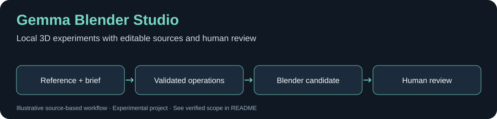

# Gemma Blender Studio


*Diagrama baseado no código; não representa uma captura da interface nem comprova execução de modelo.*


**A local, experimental 3D modeling loop with Ollama and Blender.**

Painel em português para propor operações de modelagem, gerar candidatos no Blender, comparar prévias e manter versões. O modelo não executa Python arbitrário: as operações aceitas passam por um contrato validado pelo controlador.

## Instalação inicial / First run

No Windows, com Python 3.11+ instalado, clone o projeto e prepare um ambiente isolado:

```powershell
git clone https://github.com/Michaliszyn01/gemma-blender-studio.git
cd gemma-blender-studio
py -3 -m venv .venv
```

```powershell
.\.venv\Scripts\python.exe -m pip install -r requirements.txt
.\.venv\Scripts\python.exe app.py
```

O terminal informa uma URL local `http://127.0.0.1:PORTA`, com porta escolhida na inicialização. O painel pode ser aberto sem iniciar uma geração; a modelagem exige Blender e Ollama disponíveis e configurados. O atalho `INICIAR_WINDOWS.bat` prepara o ambiente automaticamente; não é necessário executar os dois caminhos de instalação.

**Primeiro experimento sugerido:** uma caixa simples, poucas rodadas e revisão manual. Configurar e abrir o painel não comprova que o modelo criou um asset correto. Consulte [a verificação local e seus limites](docs/DEMO.md).

## Começar

1. Instale Python 3.11+, Blender e Ollama. Escolha um modelo local compatível com os recursos que deseja usar.
2. Abra `INICIAR_WINDOWS.bat` no Windows ou `sh iniciar.sh` no Linux/macOS.
3. Configure o caminho do Blender e selecione o modelo no painel.
4. Faça um primeiro teste curto: uma peça simples, três rodadas e revisão manual das prévias.

O primeiro preparo instala Pillow e exige internet. O aplicativo não inclui pesos de modelos. Não há cobrança de API de inferência pelo aplicativo; requisitos de hardware variam com o modelo escolhido.

## O que diferencia este experimento

- Operações de geometria com validação de nomes, tipos, tamanhos e caminhos.
- Candidatos e versões anteriores preservados em arquivos locais.
- Renders para inspeção e requisitos geométricos separados da opinião visual do modelo.
- Aprovação humana vinculada ao arquivo, em vez de confiar somente em uma nota da IA.
- Factory Kit de Kenney com licença original preservada.

## Validação desta publicação

`python -m unittest discover -s tests -v`: **25 testes aprovados** em 26/10/2026. Cobrem contratos, bloqueios, HTTP local, versões e aprovação. Esses testes simulam as integrações; não comprovam qualidade dos modelos, renderização na sua instalação ou fidelidade à referência.

## Limites conhecidos

É um laboratório, não um substituto de um artista 3D. A qualidade visual e a autoavaliação precisam de intervenção humana. Não use sessões longas sem acompanhamento. Escultura, retopologia, rigging, UV inteligente e exportação automática para Roblox não estão concluídos.

Dados de sessões, referências pessoais e arquivos gerados não acompanham o repositório. Veja [LEIA_PRIMEIRO.md](LEIA_PRIMEIRO.md) para a operação detalhada e as limitações históricas; os números antigos de testes nesse documento não substituem a validação acima.

## English

An experimental local workflow that turns validated modeling operations into Blender candidates, keeps previous versions, and separates geometric requirements from subjective visual reviews. Start with a short task and inspect the result yourself. The 25 automated tests do not certify real-model quality or production readiness.

## License

Application: MIT, see [LICENSE](LICENSE). Kenney Factory Kit: CC0, with its original license included in `assets/factory.zip`. No third-party robot assets or model weights are bundled.
